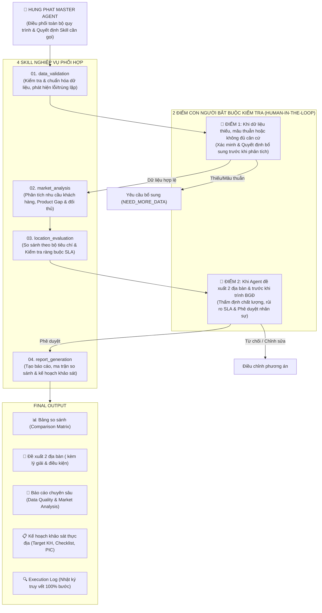

# BẢN THIẾT KẾ VÀ GIẢI PHÁP TRIỂN KHAI HUNG PHAT MASTER AGENT
## HỆ THỐNG AI AGENT HỖ TRỢ ĐỀ XUẤT ĐỊA BÀN MỞ RỘNG THỊ TRƯỜNG WMS
**Môn học:** AI301 - Ứng dụng AI trong Doanh nghiệp | **Đề số 04**  
**Doanh nghiệp giả định:** Công ty Cổ phần Giải pháp Kho thông minh Hưng Phát  
**Đối tượng thụ hưởng:** Trưởng phòng Phát triển Kinh doanh  

---

# PHẦN 1: THIẾT KẾ KIẾN TRÚC VÀ QUY TRÌNH (AGENT BLUEPRINT)

## 1. Kiến trúc 4 Skill Nghiệp vụ Phối hợp (Skill Architecture)

Thay vì xây dựng một Skill nguyên khối khổng lồ (Monolithic Skill) gây khó khăn cho việc bảo trì, truy vết và kiểm thử, hệ thống được thiết kế theo kiến trúc **Modular Multi-Skill Agent**:

---

## 2. Phân công Trách nhiệm giữa AI Agent và Con người (RACI Matrix)

Hệ thống thiết lập ranh giới trách nhiệm minh bạch, đảm bảo AI đóng vai trò **trợ lý phân tích, tính toán khách quan và đề xuất**, trong khi con người giữ quyền **giám sát, thẩm định và ra quyết định cuối cùng**:

| STT | Công việc Nghiệp vụ | Vai trò của AI Agent | Vai trò của Con người (Chuyên viên / Trưởng phòng) | Cơ chế Kiểm soát & Tiêu chuẩn Bàn giao |
|:---:|:---|:---:|:---:|:---|
| **1** | **Đọc dữ liệu** | **Thực hiện** | **Giám sát** | AI đọc tự động toàn bộ tài liệu thị trường, đối thủ, phản hồi KH và bộ tiêu chí; con người giám sát nhật ký nạp dữ liệu. |
| **2** | **Phát hiện dữ liệu lỗi** | **Thực hiện** | **Xác minh** | AI quét phát hiện trùng lặp nguồn (`duplicate_flag`), dữ liệu cũ, khuyết trường định lượng; con người xác minh và ra quyết định xử lý. |
| **3** | **Phân tích thị trường** | **Thực hiện** | **Kiểm tra** | AI phân tích nhu cầu, tính Product-Market Fit Score, đánh giá rào cản đối thủ; con người kiểm tra tính hợp lý của kết quả. |
| **4** | **So sánh 4 địa bàn** | **Thực hiện** | **Thẩm định** | AI chấm điểm ma trận đa tiêu chí (MCDA) và kích hoạt bộ lọc ràng buộc cứng SLA; con người thẩm định bảng đối chiếu. |
| **5** | **Chọn địa bàn khảo sát** | **Đề xuất** | **Quyết định** | AI xếp hạng và đề xuất Top 2 địa bàn tối ưu kèm căn cứ dữ liệu; Trưởng phòng KD đưa ra quyết định phê duyệt chính thức. |
| **6** | **Lập kế hoạch khảo sát** | **Soạn thảo** | **Phân công, phê duyệt** | AI soạn thảo nhóm khách mục tiêu và bộ câu hỏi xác minh tại kho; Trưởng phòng phân công nhân sự (PIC) và phê duyệt lịch trình. |

---

## 3. Hai Điểm Bắt buộc Con người Kiểm tra (Human-in-the-Loop Checkpoints)

### 🛑 ĐIỂM KIỂM TRA 1: Khi dữ liệu thiếu, mâu thuẫn hoặc không đủ căn cứ để đánh giá
* **Thời điểm kích hoạt:** Ngay sau Skill `01. data_validation`.
* **Điều kiện kích hoạt:**
  - Phát hiện địa bàn khuyết tài liệu thị trường hoặc khuyết mẫu khảo sát khách hàng.
  - Kỳ thống kê quá cũ (lệch trên 3 năm) hoặc có mâu thuẫn số liệu lớn giữa các nguồn độc lập.
* **Hành vi của Master Agent:** Tự động kích hoạt trạng thái **`NEED_MORE_DATA`**, lập danh sách chi tiết các trường thông tin bị thiếu và tạm dừng quy trình phân tích.
* **Trách nhiệm của con người:** Chuyên viên/Trưởng phòng kiểm tra các cờ cảnh báo, xác minh lại tài liệu gốc và nạp dữ liệu bổ sung hoặc quyết định cho phép Agent phân tích tiếp với các giả định đã ghi nhận.

### 🛑 ĐIỂM KIỂM TRA 2: Khi Agent đề xuất 2 địa bàn và trước khi trình Ban Giám đốc
* **Thời điểm kích hoạt:** Sau Skill `03. location_evaluation`, trước khi ban hành báo cáo chính thức.
* **Điều kiện thẩm định:**
  - 2 địa bàn được đề xuất bắt buộc phải **thỏa mãn 100% điều kiện SLA hỗ trợ tại chỗ** (không vi phạm giới hạn của 1 đội triển khai duy nhất).
  - Phân định rõ ràng giữa dữ kiện thực tế trong tài liệu (Fact) và nhận định suy luận của Agent (Inference).
  - Không có hiện tượng thiên vị theo quy mô thị trường mà bỏ qua mức độ khớp sản phẩm (Product-Market Fit).
* **Trách nhiệm của con người:** Trưởng phòng Phát triển Kinh doanh ký duyệt chính thức đề xuất, điều chỉnh người phụ trách (PIC) trong Kế hoạch khảo sát và ký tờ trình lên Ban Giám đốc.

---

## 4. Chi tiết 4 Skill Nghiệp vụ & Danh mục Gói Đầu ra (Final Output)

### 01. `data_validation` (Kiểm tra và chuẩn hóa dữ liệu)
* Đọc và phân loại toàn bộ gói dữ liệu dự án theo từng địa bàn.
* Phát hiện dữ liệu thiếu, số liệu trùng lặp nguồn (vd: tạp chí dẫn lại niên giám cũ).
* Giữ nguyên dữ liệu gốc, không tự ý sửa đổi số liệu.
* **Đầu ra:** Báo cáo Kiểm tra Chất lượng Dữ liệu (`1_data_quality_report.md`).

### 02. `market_analysis` (Phân tích nhu cầu và đối thủ)
* Phân tích riêng từng địa bàn: Đánh giá nhu cầu khách hàng theo danh mục tính năng.
* Đối chiếu nhu cầu với danh mục giải pháp Hưng Phát (`supported_features` vs `demanded_features`), xác định Product Gap.
* Đánh giá thị phần và mức độ độc quyền của đối thủ cạnh tranh.
* **Đầu ra:** Báo cáo Phân tích Thị trường & Đối thủ (`2_market_analysis_report.md`).

### 03. `location_evaluation` (So sánh và đánh giá địa bàn)
* Áp dụng công thức tính điểm có trọng số theo bộ tiêu chí được cung cấp.
* **Thực thi Ràng buộc Cứng (Hard Constraint):** Tự động loại bỏ các địa bàn yêu cầu hỗ trợ trực đêm 24/7 hoặc yêu cầu có mặt tức thì ở nơi Hưng Phát chưa có trạm kỹ thuật (ngăn ngừa nguy cơ vỡ SLA).
* Xếp hạng và đề xuất Top 2 địa bàn kèm lý do chưa ưu tiên các địa bàn còn lại.
* **Đầu ra:** Ma trận So sánh 4 Địa bàn (`3_comparison_matrix.md`).

### 04. `report_generation` (Báo cáo và kế hoạch khảo sát)
* Soạn thảo Báo cáo Đề xuất chính thức cho Trưởng phòng KD.
* Lập Kế hoạch khảo sát thực địa: Nhóm khách hàng mục tiêu, bộ câu hỏi xác minh tại kho (Checklist), đề xuất vai trò người phụ trách (PIC).
* Đóng gói toàn bộ nhật ký truy vết Execution Log.
* **Đầu ra:** Báo cáo Đề xuất (`4_recommendation_report.md`), Kế hoạch Khảo sát (`5_survey_plan.md`), và Execution Log (`6_execution_log.json`).

---

# PHẦN 2: MINH CHỨNG GIẢI PHÁP THỰC THI (TASK 2)

Hệ thống mã nguồn được lưu trữ tại [src/](file:///c:/Users/Lenovo/OneDrive/Tài%20liệu/Đề%204%20Hưng%20phát/src/) và đã được kiểm nghiệm qua 3 bộ test case tự động:
1. **Normal Case:** Hoàn thành toàn diện quy trình, đề xuất **Địa bàn A (Hà Nội - 8.83/10)** và **Địa bàn B (Đà Nẵng - 8.24/10)**.
2. **Missing Case:** Tự động phát hiện thiếu dữ liệu cốt lõi, kích hoạt trạng thái **`NEED_MORE_DATA`** tại Điểm kiểm tra 1.
3. **Boundary Case:** Nhận diện địa bàn có quy mô số 1 toàn quốc (`LOC_MEGA`) nhưng đòi hỏi trực đêm 24/7 vượt năng lực phục vụ, **kích hoạt Hard Constraint loại trừ `LOC_MEGA`**, bảo vệ an toàn cho đội triển khai.
